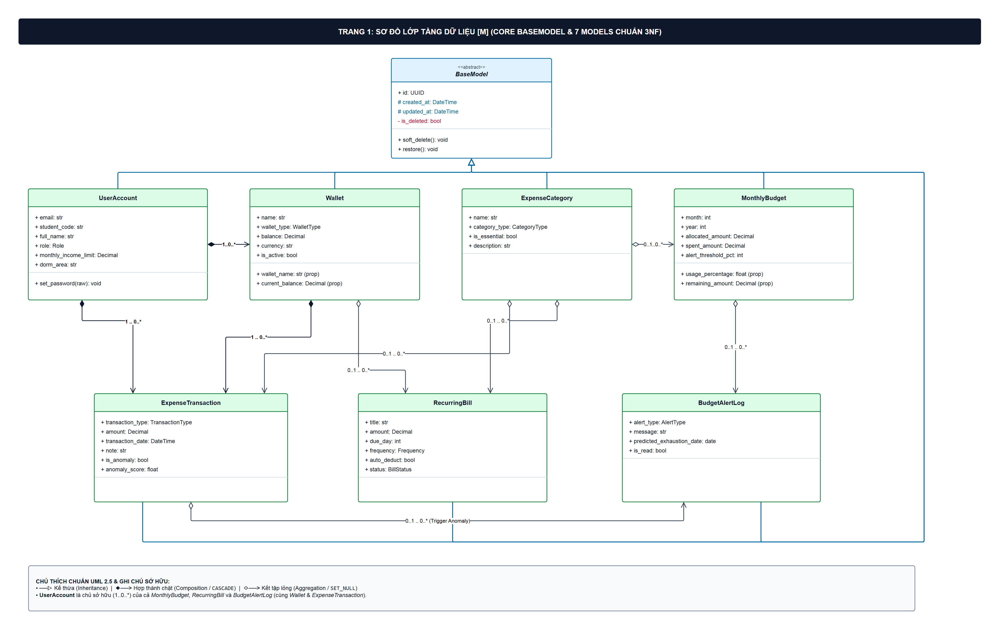
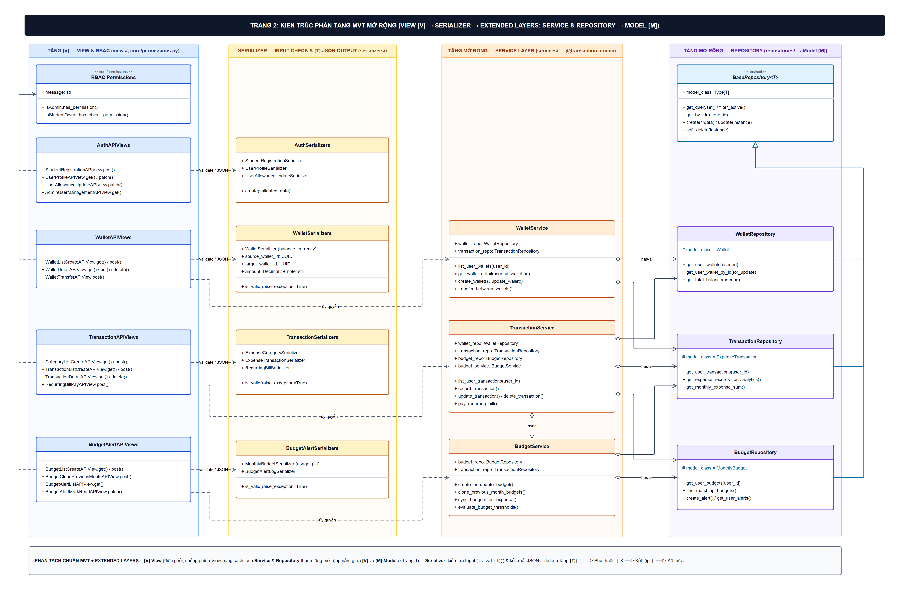
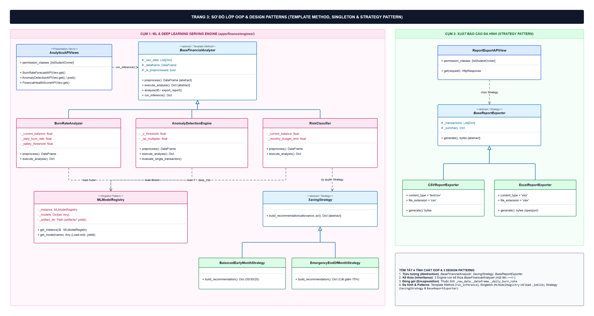
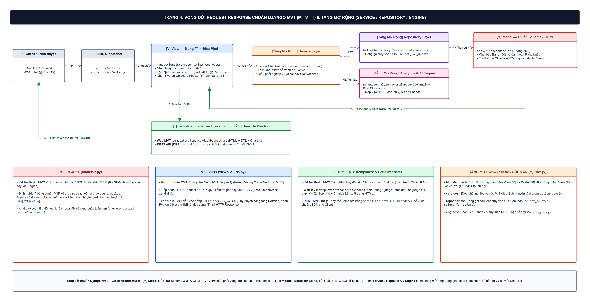
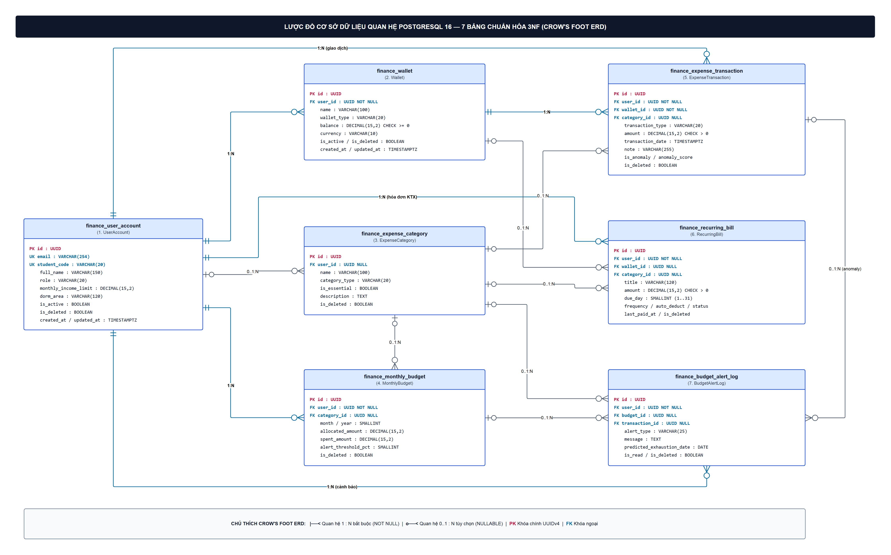
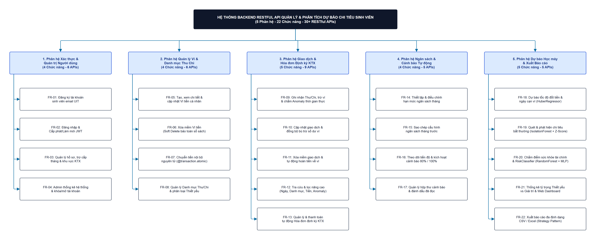
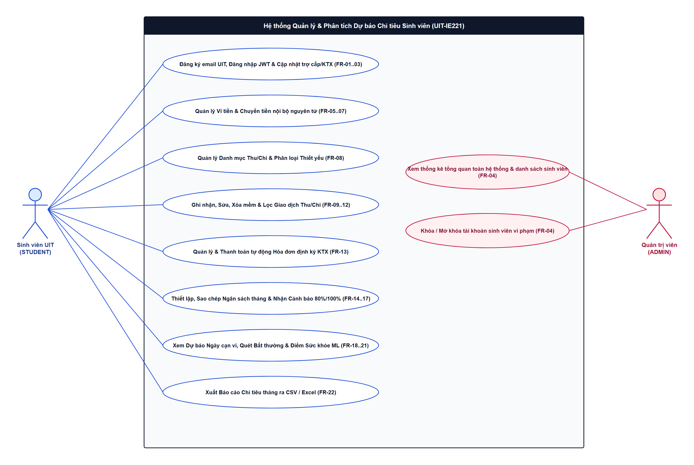

# Cẩm Nang Đọc Hiểu Nghiệp Vụ & Chuẩn Thiết Kế UML 2.5 (Toàn Bộ Sơ Đồ Hệ Thống)

Tài liệu này giải thích **rõ ràng – trực quan – không rối mắt** toàn bộ kiến trúc và nghiệp vụ bên trong 3 bộ sơ đồ chính của đồ án (kèm ảnh PNG độ phân giải cao và file PDF xuất sẵn trong [`docs/diagrams/`](diagrams/)):

- **Class Diagram (4 trang UML 2.5)**: [`UIT-IE221_Class_Diagram_Final.drawio`](../UIT-IE221_Class_Diagram_Final.drawio) | [Bản PDF 4 trang](diagrams/UIT-IE221_Class_Diagram_Final.pdf)
- **Physical ERD (7 bảng 3NF)**: [`UIT-IE221_ERD_Database_3NF.drawio`](../UIT-IE221_ERD_Database_3NF.drawio) | [Bản PDF 1 trang](diagrams/UIT-IE221_ERD_Database_3NF.pdf)
- **Phân rã Chức năng (FDD) & Use Case (2 trang)**: [`UIT-IE221_Functional_Decomposition_FDD.drawio`](../UIT-IE221_Functional_Decomposition_FDD.drawio) | [Bản PDF 2 trang](diagrams/UIT-IE221_Functional_Decomposition_FDD.pdf)

---

## 1. Quy Ước Đọc 4 Loại Mũi Tên Chuẩn UML 2.5 (Dễ Nhớ Khi Thầy Hỏi)

Trên cả 4 trang sơ đồ lớp, bạn chỉ cần nhớ đúng **4 loại mũi tên** và **3 ký hiệu phạm vi (`+`, `#`, `-`)**:

| Ký hiệu UML 2.5 | Tên gọi | Ý nghĩa trong Code Python / Django | Ví dụ thực tế trong Đồ án |
| :---: | :--- | :--- | :--- |
| **`──────▷`** *(Nét liền, tam giác rỗng)* | **Kế thừa** (*Generalization / is-a*) | `class Con(Cha):` — Lớp con thừa hưởng thuộc tính và hàm của lớp cha. | • 7 Models kế thừa `BaseModel` • 3 Repositories kế thừa `BaseRepository<T>` • 3 ML Engines kế thừa `BaseFinancialAnalyzer` |
| **`◆──────>`** *(Nét liền, hình thoi **đặc**)* | **Hợp thành chặt** (*Composition / CASCADE*) | Mối quan hệ sống còn: Xóa lớp cha thì dữ liệu lớp con gắn theo cũng bị xóa (`on_delete=CASCADE`). | • `UserAccount ◆──> Wallet` (Xóa User thì Ví mất) • `Wallet ◆──> ExpenseTransaction` |
| **`◇──────>`** *(Nét liền, hình thoi **rỗng**)* | **Kết tập lỏng** (*Aggregation / has-a / SET_NULL*) | Lớp A giữ đối tượng lớp B làm thuộc tính (hoặc `on_delete=SET_NULL`, xóa danh mục thì giao dịch vẫn còn). | • `TransactionService ◇──> WalletRepository` • `ExpenseCategory ◇──> ExpenseTransaction` |
| **`- - - ->`** *(Nét đứt, mũi tên mở)* | **Phụ thuộc tạm thời** (*Dependency / uses-a*) | Lớp A chỉ gọi/khởi tạo tạm lớp B bên trong 1 phương thức rồi thôi (không giữ làm thuộc tính). | • `APIView - - -> Serializer` (`is_valid()`) • `BurnRateAnalyzer - - -> MLModelRegistry` (`get_instance()`) |

**Ký hiệu thuộc tính**: **`+`** Public (ai cũng gọi được) | **`#`** Protected (lớp con dùng chung) | **`-`** Private (đóng gói nội bộ như `_daily_burn_rate`, `- is_deleted`).

---

## 2. Giải Thích Từng Trang Trong `UIT-IE221_Class_Diagram_Final.drawio` (4 Trang)

### Trang 01: `01 - Domain Models (7 Bảng 3NF & BaseModel)`

**Nội dung**: Cấu trúc 7 đối tượng dữ liệu cốt lõi (**tầng `M` — Model thuần túy**) của ứng dụng quản lý chi tiêu sinh viên:
- **Ở trên cùng**: Lớp trừu tượng *`BaseModel`* (`id: UUID`, `created_at`, `updated_at`, `- is_deleted`, `soft_delete()`, `restore()`). Cả 7 lớp bên dưới đều có mũi tên **`──▷`** kế thừa từ *`BaseModel`* để dùng chung khóa chính UUIDv4 và cơ chế xóa mềm (bảo toàn lịch sử sổ sách).
- **Hàng giữa (4 thực thể gốc)**:
  1. `UserAccount`: Sinh viên UIT (`email`, `student_code`, `monthly_income_limit`, `dorm_area`).
  2. `Wallet`: Các ví tiền (`Tiền mặt`, `MoMo`, `Ngân hàng`, số dư `balance >= 0`).
  3. `ExpenseCategory`: Danh mục Thu/Chi (`is_essential` phân biệt Ăn/Học với Giải trí).
  4. `MonthlyBudget`: Hạn mức ngân sách hàng tháng (`allocated_amount`, `spent_amount`, `usage_percentage`).
- **Hàng dưới (3 thực thể vận hành & cảnh báo)**:
  5. `ExpenseTransaction`: Từng giao dịch thu/chi/chuyển ví, có cờ `is_anomaly` và `anomaly_score`.
  6. `RecurringBill`: Hóa đơn cố định KTX hàng tháng (tiền phòng KTX, điện nước, 4G, `due_day`, `status`).
  7. `BudgetAlertLog`: Nhật ký cảnh báo (`WARNING_80`, `CRITICAL`, `ANOMALY`, `BURN_RATE`).

---

### Trang 02: `02 - Kiến trúc MVT Mở Rộng (View - Serializer - Service - Repository)`

**Nội dung**: Sơ đồ được chia thành **4 cột tách biệt từ Trái sang Phải** theo chuẩn **Django MVT kết hợp Tầng Mở Rộng (Clean Architecture Layers)** đặt giữa `View [V]` và `Model [M]` (ở Trang 01):
1. **Cột 1 — Tầng `[V]` (`View & RBAC`)**: Gồm `RBAC Permissions` (`IsAdmin`, `IsStudentOwner`) và 4 cụm `APIView` (`AuthAPIViews`, `WalletAPIViews`, `TransactionAPIViews`, `BudgetAlertAPIViews`). Trong Django MVT, **View** là trung tâm điều phối HTTP (vai trò Controller) — tiếp nhận Request, ủy quyền xử lý xuống `Service` thay vì viết trực tiếp logic tài chính/ORM nặng nề trong View (*tránh Fat Views*).
2. **Cột 2 — `Serializer` (`Input Check & [T] JSON Output`)**: Trong Django REST Framework (DRF), lớp `Serializer` đảm nhận 2 chiều rõ rệt:
   - **Chiều VÀO (Request)**: Giúp tầng `View [V]` lọc & kiểm tra tính hợp lệ dữ liệu đầu vào (`is_valid()`).
   - **Chiều RA (Response)**: Kết xuất đối tượng Python thành chuỗi JSON trả về cho Client (đảm nhận vai trò tầng **Trình bày `[T]`** thay thế HTML Template khi làm REST API).
3. **Cột 3 — Tầng Mở Rộng `Service Layer` (`services/` — `@transaction.atomic`)**: Lớp mở rộng độc lập (**KHÔNG gộp vào `Model [M]` hay `View [V]`**), chuyên điều phối quy tắc nghiệp vụ tài chính nguyên tử:
   - `WalletService`: Chuyển tiền nội bộ giữa 2 ví an toàn (trừ ví A, cộng ví B, ghi nhận `TRANSFER` cùng lúc).
   - `TransactionService`: Ghi nhận giao dịch hoặc thanh toán hóa đơn KTX, phối hợp cùng `BudgetService` để trừ số dư ví, chấm điểm bất thường và đồng bộ `spent_amount` của ngân sách tháng.
   - `BudgetService`: Đặt/copy ngân sách tháng trước (`clone_previous_month_budgets`) và phát sinh cảnh báo `WARNING_80` / `CRITICAL`.
4. **Cột 4 — Tầng Mở Rộng `Repository Layer` (`repositories/`)**: Lớp truy xuất dữ liệu (**KHÔNG phải `Model [M]`**), gồm `WalletRepository`, `TransactionRepository`, `BudgetRepository` kế thừa **`BaseRepository<T>`** để tái sử dụng CRUD chuẩn (`filter_active`, `get_by_id`, `create`, `update`, `soft_delete`) và đóng gói câu lệnh ORM (`select_related`, `select_for_update`) gọi xuống **`[M] Model`** ở Trang 01.

---

### Trang 03: `03 - Module Ăn Điểm OOP & Design Patterns (ML Serving & Export)`

**Nội dung**: Tách làm **2 cụm rõ rệt**, thể hiện trọn vẹn 4 tính chất OOP và 3 Design Patterns:
- **Cụm 1 (Bên trái) — ML & Deep Learning Serving Engine**:
  - `AnalyticsAPIViews` gọi `run_inference()` trên lớp cha trừu tượng *`BaseFinancialAnalyzer`* (**Template Method Pattern**: luôn chạy `preprocess()` chuyển Pandas DataFrame rồi chạy `execute_analysis()`).
  - 3 Engine con kế thừa **`──▷`** từ *`BaseFinancialAnalyzer`*:
    1. `BurnRateAnalyzer`: Dự báo tốc độ tiêu tiền & ngày cạn ví (`HuberRegressor`).
    2. `AnomalyDetectionEngine`: Phát hiện khoản chi đột biến (`IsolationForest` + Z-Score + IQR).
    3. `RiskClassifier`: Phân loại rủi ro vỡ ngân sách (`RandomForestClassifier` + `MLPClassifier` 2 tầng ẩn) & chấm điểm sức khỏe tài chính (0–100).
  - **Singleton Pattern (`MLModelRegistry`)**: Cả 3 Engine đều gọi `MLModelRegistry.get_instance().get_model(...)` để **chỉ nạp (load-only)** các file trọng số đã đóng gói sẵn từ `artifacts/*.joblib` (`burn_rate_huber.joblib`, `anomaly_iforest.joblib`, `risk_rf_classifier.joblib`, `deep_mlp_risk.joblib`) lên RAM đúng 1 lần duy nhất.
  - **Strategy Pattern (`SavingStrategy`)**: `RiskClassifier` ủy quyền đa hình cho `SavingStrategy` để chọn `BalancedEarlyMonthStrategy` (quy tắc 50/30/20 khi an toàn) hoặc `EmergencyEndOfMonthStrategy` (cắt giảm 75% chi tiêu không thiết yếu khi sắp cạn ví).
- **Cụm 2 (Bên phải) — Xuất Báo Cáo Đa Hình (`BaseReportExporter`)**:
  - `ReportExportAPIView` chọn Strategy dựa trên tham số `?export_format=csv|xlsx` và gọi chung 1 hàm `generate()` trên `CSVReportExporter` hoặc `ExcelReportExporter`.

---

### Trang 04: `04 - Vòng Đời Request MVT & Tách Biệt Service/Repo/Engine`

**Nội dung (Đúng chuẩn vòng đời 6 bước Django MVT & tách riêng Tầng Mở Rộng khỏi `[M]`):**
1. **Bước 1 & 2 (Request & Routing)**: `Client` gửi HTTP Request → `URL Dispatcher` (`config/urls.py`, `apps/finance/urls.py`) định tuyến đến **`View [V]`**.
2. **Bước 3 (View điều phối qua Tầng Mở Rộng → Model `[M]`)**: `TransactionListCreateAPIView [V]` kiểm tra RBAC và lọc dữ liệu API đầu vào qua `Serializer.is_valid()`, sau đó gọi **`Service Layer`** (Tầng Mở Rộng) → rẽ xuống **`Repository Layer`** (truy vấn ORM vào **`[M] Model`** — 7 bảng 3NF thuần schema & ORM) và **`Analytics & AI Engine`** (nạp `.joblib` suy luận).
3. **Bước 4 (`[M] Model` trả Python Object về `[V] View`)**: Dữ liệu đối tượng Python (ORM instances) từ **`Model [M]`** được trả ngược về trung tâm điều phối **`View [V]`**.
4. **Bước 5 (`[V] View` truyền dữ liệu sang `[T] Template / Serializer`)**:
   - Với **Web MVT** (`/dashboard/`): View truyền context sang `templates/finance/dashboard.html` (HTML + Django Template Language + Chart.js).
   - Với **REST API** (`/api/v1/...`): View truyền object qua `Serializer.data` + `JSONRenderer` để kết xuất chuỗi JSON.
5. **Bước 6 (HTTP Response)**: Trả trang HTML hoặc JSON hoàn chỉnh về `Client`.
- **Phần dưới (4 thẻ tóm tắt đối chiếu)**: Tách rạch ròi **`M — Model`** (thuần `models/*.py` định nghĩa bảng 3NF & ORM), **`V — View`** (điều phối HTTP & RBAC), **`T — Template`** (`templates/*.html` & `Serializer.data` chỉ làm nhiệm vụ hiển thị đầu ra), và **`Tầng Mở Rộng`** (`services/`, `repositories/`, `engines/` không bị gộp nhầm vào `M` hay `V`).

---

## 3. Giải Thích Sơ Đồ ERD 7 Bảng 3NF (`UIT-IE221_ERD_Database_3NF.drawio`)

**Nội dung**: Mô hình vật lý CSDL PostgreSQL 16 gồm đúng **7 bảng chuẩn hóa 3NF** theo ký hiệu **Crow's Foot**:
- **Khóa chính (PK) & Soft Delete**: Mọi bảng đều dùng `id : UUID` (UUIDv4, chống dò quét ID tuần tự) và cột `is_deleted : BOOLEAN` để xóa mềm, không làm đứt gãy lịch sử sổ sách tài chính.
- **Ký hiệu quan hệ Crow's Foot**:
  - **`|──<` (Nét liền xanh — `1 : N` bắt buộc / `NOT NULL`)**: Như `finance_user_account` → `finance_wallet`, `finance_expense_transaction`, `finance_monthly_budget`, `finance_recurring_bill`, `finance_budget_alert_log` (mọi bản ghi ví/giao dịch/ngân sách đều phải thuộc về một sinh viên xác định).
  - **`o──<` (Nét xám — `0..1 : N` tùy chọn / `NULLABLE` / `SET NULL`)**: Như `finance_expense_category` (`category_id NULL`) cho phép lưu danh mục hệ thống mặc định hoặc giữ nguyên giao dịch lịch sử nếu danh mục bị xóa.
- **Ràng buộc toàn vẹn mức CSDL (`CheckConstraint` & `UniqueConstraint`)**: `balance >= 0` trên bảng ví `finance_wallet`, `amount > 0` trên `finance_expense_transaction` và `finance_recurring_bill`.

---

## 4. Giải Thích Sơ Đồ Phân Rã Chức Năng (FDD) & Use Case (`UIT-IE221_Functional_Decomposition_FDD.drawio`)

### Trang 01: Sơ đồ Phân rã Chức năng (FDD — 5 Phân hệ / 22 Chức năng)

**Nội dung**: Ánh xạ trực tiếp từ tài liệu đặc tả [`functional_requirements_srs.md`](functional_requirements_srs.md) thành **5 nhánh phân hệ độc lập (`M1` → `M5`)** gồm **22 chức năng (`FR-01` → `FR-22`)**:
1. **Phân hệ 1 — Xác thực & Quản trị Người dùng** (`FR-01`..`FR-04` / 6 APIs): Đăng ký email UIT, JWT Login/Refresh, cập nhật trợ cấp/KTX và Admin quản lý người dùng.
2. **Phân hệ 2 — Quản lý Ví & Danh mục Thu Chi** (`FR-05`..`FR-08` / 6 APIs): CRUD & xóa mềm Ví tiền, chuyển tiền nội bộ nguyên tử `@transaction.atomic`, phân loại Danh mục Thiết yếu.
3. **Phân hệ 3 — Giao dịch & Hóa đơn Định kỳ KTX** (`FR-09`..`FR-13` / 9 APIs): Ghi/sửa/xóa hoàn tiền giao dịch + chấm điểm bất thường, lọc đa tiêu chí, thanh toán tự động hóa đơn KTX.
4. **Phân hệ 4 — Ngân sách & Cảnh báo Tự động** (`FR-14`..`FR-17` / 5 APIs): Thiết lập/sao chép ngân sách tháng, cảnh báo ngưỡng 80% / 100%, đánh dấu đã đọc cảnh báo.
5. **Phân hệ 5 — Dự báo Học máy & Xuất Báo cáo** (`FR-18`..`FR-22` / 5 APIs): Dự báo Burn-rate (`HuberRegressor`), quét Anomaly (`IsolationForest` + Z-Score), chấm điểm Sức khỏe Tài chính (`RandomForest` + `Deep MLP`), thống kê Dashboard và xuất CSV/Excel.

### Trang 02: Sơ đồ Use Case Tổng quan (`STUDENT` & `ADMIN`)

**Nội dung**: Phân tách rạch ròi quyền hạn của **2 Tác nhân (Actors)** thông qua hệ thống RBAC (`IsStudentOwner` vs `IsAdmin`):
- **Sinh viên UIT (`STUDENT`)**: Thực hiện 8 cụm nghiệp vụ cốt lõi từ đăng ký/quản lý ví/giao dịch/hóa đơn KTX/ngân sách đến xem dự báo ML và xuất báo cáo CSV/Excel (`FR-01`..`FR-03`, `FR-05`..`FR-22`).
- **Quản trị viên (`ADMIN`)**: Chỉ quản trị ở mức hệ thống — xem thống kê tổng quan, danh sách sinh viên và khóa/mở khóa tài khoản vi phạm (`FR-04`), không can thiệp dữ liệu chi tiêu riêng tư.

---

## 5. Câu Hỏi Thường Gặp Khi Bảo Vệ: `Service`, `Repository`, `Engine` Có Phải `View` / `Controller` Không?

**Trả lời dứt khoát: KHÔNG.** `Service`, `Repository`, `Engine` **không phải `View`** (trong MVT) và cũng **không phải `Controller`** (trong MVC).

Cần phân biệt rõ **2 loại "logic"** trong một ứng dụng Web Backend:

| Loại Logic | Đảm nhiệm trong Đồ án | Vai trò cụ thể | Thuộc tầng nào? |
| :--- | :--- | :--- | :--- |
| **1. Logic điều phối HTTP** *(Presentation / Controller Logic)* | `views/`, `urls.py`, `core/permissions.py` | Nhận `HttpRequest`, kiểm tra JWT & quyền RBAC (`IsStudentOwner`, `IsAdmin`), kiểm tra payload đầu vào (`Serializer.is_valid()`), quyết định HTTP status (`200/201/400/403/404`), rồi đẩy kết quả sang `[T]` (`Template` HTML hoặc `Serializer.data` JSON). | **`View [V]`** *(tương đương `Controller` trong MVC)* |
| **2. Logic nghiệp vụ, tính toán AI & truy xuất dữ liệu** *(Business / Domain & Data Access Logic)* | `services/`, `engines/`, `repositories/` | Hoàn toàn **độc lập với HTTP** (không nhận `HttpRequest`, không trả `HttpResponse` — dùng chung được cho REST API, Web, CLI hay Unit Test `pytest`): • `Service`: Luật nghiệp vụ tiền tệ & giao dịch `@transaction.atomic`. • `Engine`: Pandas & nạp sẵn model ML/DL `.joblib`. • `Repository`: Đóng gói ORM query an toàn giao tiếp với `Model [M]`. | **Tầng Mở Rộng (Extended Layers)** đặt giữa `View [V]` và `Model [M]` |

> **Chốt câu trả lời với giảng viên**: Trong Django MVT tối giản, do chỉ có 3 file nên nghiệp vụ hay bị viết tạm trong `View` hoặc `Model`. Khi mở rộng theo **MVT + Clean Architecture**, nhóm tách phần nghiệp vụ, AI và truy vấn ORM thành **Tầng Mở Rộng** nằm giữa `View [V]` và `Model [M]` để `View` giữ đúng vai trò điều phối HTTP mỏng nhẹ (*Thin View*), `Model` thuần cấu trúc bảng 3NF & ORM, còn code nghiệp vụ dùng lại được ở nhiều API (như `TransactionService.record_transaction()` dùng chung cho cả ghi chi tiêu tay và thanh toán hóa đơn KTX).
