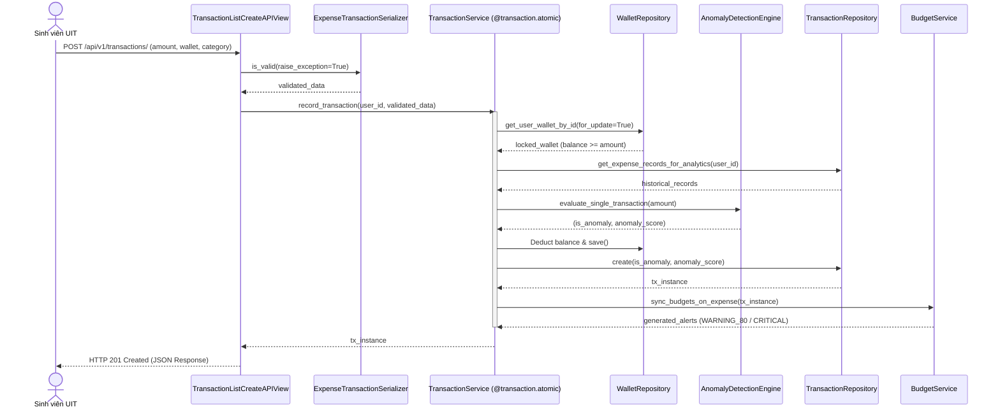

# Bộ Sơ Đồ Kỹ Thuật Chuẩn StarUML (Khớp 1:1 với Codebase Đồ án IE221)

Tài liệu này cung cấp đầy đủ 4 sơ đồ chuẩn để bạn vẽ vào StarUML hoặc xuất ảnh đưa vào Mục 2, 3, 4 của Báo cáo Word (`Template_IE221_New.docx`):
1. **Sơ đồ Phân rã Chức năng (FDD - 5 Phân hệ, 22 Chức năng)**
2. **Lược đồ Cơ sở Dữ liệu Quan hệ (ERD - 7 Bảng chuẩn 3NF)**
3. **Sơ đồ Lớp (UML Class Diagram - Ánh xạ 1:1 với OOP & Design Patterns)**
4. **Sơ đồ Tuần tự (Sequence Diagram - Luồng Ghi nhận Giao dịch & ML Inference)**

---

## 1. Sơ đồ Phân rã Chức năng (FDD - 5 Phân hệ / 22 Chức năng)

```mermaid
flowchart TD
    Root["HỆ THỐNG QUẢN LÝ & PHÂN TÍCH DỰ BÁO CHI TIÊU SINH VIÊN (22 CHỨC NĂNG - 30 APIs)"]

    M1["1. Phân hệ Xác thực & Quản trị (4 CN)"]
    M2["2. Phân hệ Quản lý Ví & Danh mục (4 CN)"]
    M3["3. Phân hệ Giao dịch & Hóa đơn KTX (5 CN)"]
    M4["4. Phân hệ Ngân sách & Cảnh báo (4 CN)"]
    M5["5. Phân hệ Phân tích Dự báo ML & Báo cáo (5 CN)"]

    Root --> M1
    Root --> M2
    Root --> M3
    Root --> M4
    Root --> M5

    M1 --> F1_1["1.1. Đăng ký tài khoản email UIT"]
    M1 --> F1_2["1.2. Đăng nhập & Cấp phát/Làm mới JWT"]
    M1 --> F1_3["1.3. Quản lý hồ sơ, trợ cấp & khu vực KTX"]
    M1 --> F1_4["1.4. Admin quản lý tài khoản & thống kê hệ thống"]

    M2 --> F2_1["2.1. Tạo, xem, cập nhật Ví tiền (Tiền mặt/MoMo/Bank)"]
    M2 --> F2_2["2.2. Xóa mềm Ví tiền (Soft Delete)"]
    M2 --> F2_3["2.3. Chuyển tiền nội bộ nguyên tử (@transaction.atomic)"]
    M2 --> F2_4["2.4. Quản lý Danh mục Thu/Chi & Phân loại Thiết yếu"]

    M3 --> F3_1["3.1. Ghi nhận giao dịch Thu/Chi & Đồng bộ số dư ví"]
    M3 --> F3_2["3.2. Sửa/Xóa mềm giao dịch & Hoàn tiền tự động"]
    M3 --> F3_3["3.3. Tra cứu & Lọc đa tiêu chí (Ngày, Danh mục, Anomaly)"]
    M3 --> F3_4["3.4. Quản lý Hóa đơn định kỳ KTX (Phòng, Điện nước, 4G)"]
    M3 --> F3_5["3.5. Kích hoạt thanh toán tự động Hóa đơn định kỳ"]

    M4 --> F4_1["4.1. Thiết lập & Điều chỉnh hạn mức ngân sách tháng"]
    M4 --> F4_2["4.2. Sao chép cấu hình ngân sách tháng trước"]
    M4 --> F4_3["4.3. Theo dõi tiến độ & Kiểm tra ngưỡng 80%/100%"]
    M4 --> F4_4["4.4. Quản lý nhật ký cảnh báo & Đánh dấu đã đọc"]

    M5 --> F5_1["5.1. Dự báo tốc độ đốt tiền & Ngày cạn ví (HuberRegressor)"]
    M5 --> F5_2["5.2. Phát hiện giao dịch bất thường (IsolationForest + Z-Score)"]
    M5 --> F5_3["5.3. Phân loại rủi ro & Chấm điểm sức khỏe tài chính (RandomForest)"]
    M5 --> F5_4["5.4. Thống kê tỷ trọng Essential vs Non-essential (Pandas)"]
    M5 --> F5_5["5.5. Xuất báo cáo tài chính đa định dạng CSV/Excel (Strategy)"]
```

---

## 2. Sơ đồ Lớp (StarUML Class Diagram - Map 1:1 với Code OOP)

```mermaid
classDiagram
    class BaseModel {
        <<abstract>>
        +UUID id
        +DateTime created_at
        +DateTime updated_at
        + bool is_deleted
        +soft_delete() void
        +restore() void
    }

    class BaseRepository~T~ {
        +Type~T~ model_class
        +get_queryset() QuerySet~T~
        +filter_active(**filters) QuerySet~T~
        +get_by_id(record_id) T
        +create(**data) T
        +update(instance, **data) T
        +soft_delete(instance) T
    }

    class BaseFinancialAnalyzer {
        <<abstract>>
        #List~Dict~ _raw_data
        #DataFrame _dataframe
        #bool _is_preprocessed
        +dataframe() DataFrame
        +preprocess()* DataFrame
        +execute_analysis()* Dict
        +analyze(dataframe) Dict
        +export_report() Dict
        +run_inference() Dict
    }

    class MLModelRegistry {
        <<Singleton>>
        -MLModelRegistry _instance$
        -Dict _models
        +get_instance()$ MLModelRegistry
        +get_model(model_name) Any
    }

    class BurnRateAnalyzer {
        #float _current_balance
        #float _daily_burn_rate
        #float _safety_threshold
        +daily_burn_rate() float
        +preprocess() DataFrame
        +execute_analysis() Dict
    }

    class AnomalyDetectionEngine {
        #float _z_threshold
        #float _iqr_multiplier
        +preprocess() DataFrame
        +execute_analysis() Dict
        +evaluate_single_transaction(candidate_amount) Tuple~bool, float~
    }

    class RiskClassifier {
        #float _current_balance
        #float _monthly_budget_limit
        +preprocess() DataFrame
        +execute_analysis() Dict
    }

    class SavingStrategy {
        <<abstract>>
        +build_recommendation(safe_daily_allowance, non_essential_pct)* Dict
    }

    class BalancedEarlyMonthStrategy {
        +build_recommendation(safe_daily_allowance, non_essential_pct) Dict
    }

    class EmergencyEndOfMonthStrategy {
        +build_recommendation(safe_daily_allowance, non_essential_pct) Dict
    }

    class BaseReportExporter {
        <<abstract>>
        #List _transactions
        #Dict _summary
        +generate()* bytes
    }

    class CSVReportExporter {
        +generate() bytes
    }

    class ExcelReportExporter {
        +generate() bytes
    }

    BaseFinancialAnalyzer <|-- BurnRateAnalyzer
    BaseFinancialAnalyzer <|-- AnomalyDetectionEngine
    BaseFinancialAnalyzer <|-- RiskClassifier
    RiskClassifier ..> MLModelRegistry : uses Singleton
    RiskClassifier ..> SavingStrategy : delegates Strategy
    SavingStrategy <|-- BalancedEarlyMonthStrategy
    SavingStrategy <|-- EmergencyEndOfMonthStrategy
    BaseReportExporter <|-- CSVReportExporter
    BaseReportExporter <|-- ExcelReportExporter
```

---

## 3. Sơ đồ Tuần tự (Sequence Diagram - Luồng Ghi nhận Chi tiêu & Chấm điểm Anomaly)

